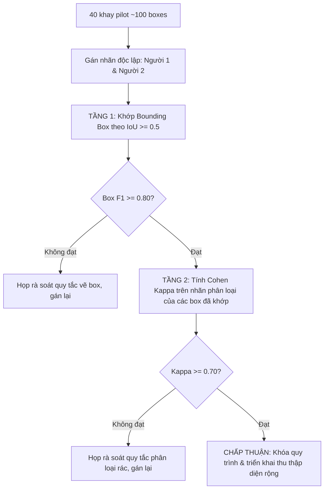

# Hướng dẫn Quy ước Gán nhãn Rác Canteen Đại học (Label Guide v2.0)

> **Cập nhật theo Kế hoạch MASTER v10.0 (§3.4)**: Áp dụng cho ảnh khay ăn đa vật thể, phục vụ pipeline 2 giai đoạn (Detector D1 class-agnostic $\rightarrow$ KD Classifier 3 nhóm + `background`).

---

## 1. Ba nhóm quyết định bỏ rác + Lớp Nền (`background`)

| Nhóm nhãn | Tên tiếng Anh | ID | Định nghĩa & Ý nghĩa xử lý |
|---|---|---|---|
| **Hữu cơ** | `organic` | 0 | Rác phân hủy sinh học: thức ăn thừa, cơm thừa, vỏ trái cây, xương, phụ phẩm nông nghiệp. Đưa đi ủ compost hoặc chăn nuôi. |
| **Tái chế khô** | `recyclable` | 1 | Vật liệu có giá trị tái chế cao và **ở trạng thái sạch / ráo**: chai nhựa PET ráo nước, lon kim loại, bìa carton sạch khô. |
| **Còn lại / Khó tái chế** | `other_landfill` | 2 | Rác bẩn dính dầu mỡ, hộp xốp, ly giấy tráng PE, túi nilon mềm, muỗng nĩa nhựa 1 lần, khăn giấy ăn bẩn. Đưa đi chôn lấp/đốt rác. |
| **Lớp Nền / Ngoại lai** *(Chỉ dùng cho Classifier)* | `background` | 3 | Vùng mặt bàn, mép khay rỗng, dụng cụ ăn uống tái sử dụng của trường học (thìa dĩa inox, khay nhựa) hoặc các crop dương tính giả do Detector D1 sinh ra. |

---

## 2. Danh mục vật phẩm canteen đại học điển hình

### 2.1 Nhóm Hữu cơ (`organic`)
- Cơm thừa, mì, bún, phở (đã ráo nước sốt chính).
- Vỏ trái cây (cam, chuối, dưa hấu, táo...).
- Xương gà, xương cá, thịt thừa, rau củ thừa.
- Vỏ trứng, bã trà, bã cà phê.
- Đồ ăn vặt thừa (bánh tráng, bánh mì ăn dở không kèm bao bì).

### 2.2 Nhóm Tái chế khô (`recyclable`)
- **Chai nhựa PET**: Chai nước khoáng (Lavie, Aquafina...), chai trà xanh/nước ngọt đã uống cạn, ráo nước.
- **Lon kim loại**: Lon nhôm nước ngọt (Coca, Pepsi...), lon bia, lon trà đã uống cạn.
- **Hộp giấy / Bìa carton khô**: Hộp sữa tiệt trùng (đã uống cạn, dẹp phẳng), bìa carton sạch không dính mỡ.
- **Ly nhựa sạch**: Ly nhựa PP/PET (trà tắc, nước mía) đã đổ sạch đá/nước, không bám cặn thức ăn.

### 2.3 Nhóm Còn lại / Khó tái chế (`other_landfill`)
- **Hộp xốp thực phẩm**: Hộp xốp (EPS) đựng cơm tấm, xôi, bánh bao (thường dính mỡ, dầu hành, nước mắm).
- **Đồ dùng ăn uống 1 lần**: Muỗng, nĩa, dao nhựa dùng 1 lần; que khuấy; ống hút nhựa.
- **Giấy bẩn**: Khăn giấy lau miệng, khăn ướt, giấy ăn dính dầu mỡ/nước sốt, tăm tre.
- **Bao bì mềm & Túi nilon**: Túi nilon đựng đồ ăn, màng bọc thực phẩm, túi bánh kẹo tráng màng nhôm.
- **Ly giấy tráng màng PE bẩn**: Ly cà phê giấy, tô mì giấy đã qua sử dụng dính nước dùng.

---

## 3. Quy tắc xử lý các ca ranh giới (Contamination & Edge Cases)

Nguyên tắc cốt lõi: **"Nếu nghi ngờ gây nhiễm bẩn thùng tái chế $\rightarrow$ Xếp vào Còn lại (`other_landfill`)"**.

1. **Ly trà sữa / nước ngọt còn đá hoặc trân châu:**
   - Nếu vật phẩm chụp ở trạng thái nguyên vẹn còn chất lỏng/thức ăn bên trong $\rightarrow$ Gán nhãn `other_landfill` (vì nếu ném cả ly vào thùng tái chế sẽ làm hỏng toàn bộ giấy/nhựa khác).
   - Ghi chú: Gắn cờ `ambiguous = True`.
2. **Hộp xốp đựng đồ ăn:**
   - Dù sạch hay bẩn $\rightarrow$ Mặc định gán nhãn `other_landfill` (xốp EPS trong canteen trường học tại VN hầu như không có cơ sở thu gom tái chế hiệu quả).
3. **Chai nhựa còn nắp và nhãn:**
   - Vẫn gán `recyclable` nếu chai đã cạn nước.
4. **Hộp bã mía / Bao bì sinh học dính thức ăn:**
   - Tại điều kiện phân loại rác thông thường tại trường học hiện nay $\rightarrow$ Gán `other_landfill`.
5. **Vật thể lạ / Rác văn phòng rơi vào khay ăn (bút bi, kẹp bấm, khẩu trang):**
   - Mặc định xếp vào `other_landfill`.

---

## 4. Quy chuẩn vẽ Bounding Box trên Khay Canteen (MASTER v10.0 §3.4)

### 4.1 Phân định Rác vs Dụng cụ Canteen của Trường học
- **Khay ăn, đĩa sứ/nhựa, bát tô, thìa/đũa inox tái sử dụng của trường:** **TUYỆT ĐỐI KHÔNG VẼ BOX RÁC**. Đây là tài sản canteen gom rửa tái sử dụng.
- **Thức ăn thừa bên trong đĩa/bát/khay:** Vẽ box bọc sát **phần thức ăn thừa** (gán `organic`), không bọc mép bát đĩa trừ khi thức ăn phủ kín toàn bộ.
- **Hộp xốp/Hộp nhựa 1 lần:** Vẽ box bọc trọn toàn bộ hộp (kể cả có dính thức ăn bên trong).
- **Vật nhỏ tách rời (muỗng nhựa 1 lần, ống hút, khăn giấy, tăm):** Mỗi vật thể là **1 box riêng biệt**. Không gộp các vật khác loại vào 1 box.
- **Cụm rác đồng chất dính liền (khăn giấy vo viên thành đống, một đĩa nhiều mảnh xương gà):** Vẽ **1 box bao trọn cụm rác đó**.

### 4.2 Độ bao sát (Tightness) & Xử lý Che khuất (Occlusion)
- **Độ ôm sát:** Bounding box phải ôm sát đường biên ngoài của vật thể (tight bounding box), sai số viền không vượt quá 5% kích thước vật.
- **Che khuất một phần ($< 80\%$):** Vẽ box bao quanh **phần nhìn thấy được** (visible box) của vật thể.
- **Che khuất nghiêm trọng ($\ge 80\%$):** Bỏ qua không gán box để tránh gây nhiễu cho detector.
- **Ngưỡng kích thước tối thiểu:** Bỏ qua các vật nhỏ hơn **$16 \times 16$ pixel** trên ảnh gốc (ví dụ: vài hạt cơm rơi vãi, mẩu giấy vụn li ti).

---

## 5. Định dạng Dữ liệu & Metadata Khay Canteen

### 5.1 File tọa độ nhãn YOLO TXT (`labels/<split>/<image_name>.txt`)
Mỗi dòng đại diện cho một vật thể:
```
<class_id> <x_center> <y_center> <width> <height>
```
*(Tọa độ chuẩn hóa trong khoảng $[0.0, 1.0]$. Đối với Detector D1 class-agnostic, `class_id = 0`)*

### 5.2 File Metadata (`data/canteen_metadata.csv`)
```csv
image_id,cluster_id,date,shift,device,light_condition,total_boxes,organic_count,recyclable_count,other_count,ambiguous,annotator_1,annotator_2
```
- `image_id`: Tên file ảnh (ví dụ: `canteen_20261015_001.jpg`).
- `cluster_id`: Mã cụm chia tập (Định dạng: `YYYYMMDD_Ca`, ví dụ: `20261015_trua`).
- `light_condition`: Điều kiện ánh sáng (`indoor_natural`, `indoor_fluorescent`, `outdoor_shadow`).
- `ambiguous`: `True` nếu chứa vật thể có độ ranh giới tranh cãi.

---

## 6. Quy trình Kiểm định Độ đồng thuận 2 Tầng (Inter-Annotator Agreement)

Nhằm đảm bảo chất lượng nhãn trước khi thu thập diện rộng, tiến hành đánh giá trên **$\sim 40$ khay mẫu ($\ge 100$ bounding boxes)** được gán nhãn độc lập bởi 2 người:



1. **Tầng 1 - Độ đồng thuận vị trí Bounding Box (Box Position Agreement):**
   - Ghép cặp box giữa Người 1 và Người 2 bằng thuật toán Hungarian / Greedy với ngưỡng $\text{IoU} \ge 0.5$.
   - Tính Precision, Recall và $F_1$-score định vị:
     $$\text{Box } F_1 = \frac{2 \cdot \text{Matched Boxes}}{\text{Total Boxes}_1 + \text{Total Boxes}_2}$$
   - **Tiêu chuẩn chấp thuận:** $\text{Box } F_1 \ge 0.80$.

2. **Tầng 2 - Độ đồng thuận phân loại rác (Classification Agreement):**
   - Trên các cặp bounding box đã khớp thành công ở Tầng 1, tính hệ số Cohen's Kappa giữa 2 người:
     $$\kappa = \frac{p_o - p_e}{1 - p_e}$$
   - **Tiêu chuẩn chấp thuận:** $\kappa \ge 0.70$.

3. **Xử lý vi phạm tiêu chuẩn:**
   - Bắt buộc dừng toàn bộ hoạt động thu thập mới.
   - Mở phiên họp đối soát từng box bất đồng, bổ sung trường hợp vào mục 3 & 4 của tài liệu này, sau đó gán lại trên 40 khay thử nghiệm mới.

